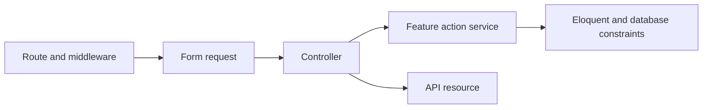

# Architecture and feature boundaries

The system is a layered Laravel application with feature-specific action services. The API, owner frontend, and platform admin are separate Git repositories and deployable applications. They share one API and its database. Keep changes organized around the business feature; the present architecture does not require distributed services or a repository wrapper around every Eloquent model.

## API request flow

- Routes define authentication, active-user, store-member, or platform-admin access. API endpoints are versioned under `/api/v1`.
- Form requests validate supported input and prohibit ownership, actor, balance, and other protected fields. IDs from a request are still resolved through the authorized store/account inside the service.
- Controllers coordinate the request, action, and response. Action services own business rules and transaction boundaries. Resources explicitly select public fields instead of returning unrestricted models.
- Owner actions live under feature directories such as `Services/Catalog`, `Customers`, `Sales`, and `Plans`. Platform operations belong under the corresponding `Admin` controller/request/resource/service namespaces. Shared authentication and models remain shared where appropriate.

## Tenant access and history

Platform administrators are independent users; creating one does not create a store or owner membership. Their administrative endpoints expose platform metadata. Access to a private POS workspace still requires the store's active owner membership. Scope child queries and bindings to the authorized parent; never use a request-supplied store/account identifier as proof of access.

Composite tenant foreign keys and store-scoped unique constraints reinforce service checks. Preserve these when adding tables or relationships. The client and admin currently share a cookie identity when using the same browser/session domain; role enforcement remains the API's responsibility.

Platform-admin roster changes use a singleton roster lock before user rows in ID order. Other privileged writes keep their domain lock order (account/store or plan, then actor user) and recheck active administrator status and revision under that user lock. They do not acquire the roster lock after a domain lock. Login/session revisions prevent revoked sessions from returning after reactivation; see [administrator management](../ADMIN_USERS_SETUP.md).

Sale, stock, customer ledger, subscription, cash-closing, and administrative status history preserve recorded facts. Store monetary amounts as integer centavos. Return totals as decimal strings when they can exceed JavaScript's safe integer range, and use exact integer arithmetic in the clients. Keep historical names, prices, units, and terms in snapshots where already defined.

Choose a product's unit at creation. Once stock or history exists, changing the label would reinterpret quantities; create a distinct product for a different unit. A legacy sale-unit mismatch cannot be automatically restocked. Financial reversal without restock remains available; see [catalog](../CATALOG_SETUP.md) and [reversals](../OPERATIONS_SETUP.md).

## Transactions and database access

Workspace writes use `Services/Stores/StoreWriteAccess` inside their transaction to lock the account, then the store, and recheck both statuses before changing data. They then lock the customer/product/inventory rows they modify. Admin account/store status changes coordinate on the same account-first order, so a request admitted before suspension cannot bypass a later committed restriction. Catalog quota and subscription writes also coordinate on the account lock. Preserve this lock order and transactional audit writes when extending those actions. Use batch reads/locks for collections rather than a relationship query inside an item loop. See [status management](../ADMIN_STATUS_SETUP.md).

Eager-load the relationships a response will render, paginate lists, and keep tenant/filter predicates in SQL. Query-count tests check that reads do not grow with returned rows or checkout items. They complement indexes and measurements; they do not establish a production latency or capacity guarantee.

The centralized admin Activity Log reads the four existing audit sources with SQL filters before a union of small headers. Cursor pagination precedes at most four batched source reads; resources expose explicit audit metadata. Names use historical snapshots, with an honest missing-name label for legacy plan actors. This is a live ordered feed, not a frozen report. Do not duplicate source events into a second audit table or infer unrecorded actions; see [activity setup](../ADMIN_ACTIVITY_SETUP.md).

Subscription monitoring uses the shared current-validity scope, SQL interval windows to merge continuous remaining paid periods, and SQL search/state filters before pagination. Fixed batches hydrate only the selected current/next plan snapshots, avoiding per-account effective-plan queries. Expiring is an overlapping flag within current paid states, while account suspension remains separate. See [monitoring setup](../SUBSCRIPTION_MONITORING_SETUP.md).

Read-only customer statements capture their upper immutable ledger ID and balance while holding the short store lock. Aggregation and pagination then run after that transaction ends, bounded by the captured ID. Do not put slow reports or exports inside a financial write lock when a stable immutable snapshot can be used instead.

## Frontend and admin

Keep `App.tsx` focused on providers and routing. Pages compose feature components, hooks, typed API adapters, and shared UI. Both applications wrap lazy routes in a loading/error boundary with a reload path. The owner frontend enforces strict TypeScript checks.

Queries should cancel abandoned requests and avoid displaying results for a different query or workspace. Key workspace state by user/store; scope recovery storage by the same identity. Do not attach another store's data to a newly selected workspace.

For non-repeatable writes, persist the exact request and its idempotency key **before** POST. An uncertain response does not mean failure. Freeze that operation, retain its original key through navigation/remount, and confirm or replay it before allowing another operation. A late response after unmount must not silently acknowledge the user's unresolved write. Distinguish a known action rejection from an error during CSRF/session preparation. See [stock recovery](../CATALOG_SETUP.md) and each financial feature's setup guide.

## Validation and releases

| Check | Purpose |
| --- | --- |
| Default API suite | Isolated SQLite validation, tenant/auth rules, domain behavior, rollback and query growth |
| Opt-in MySQL suite | Real overlapping checkout, repayment, activation, renewal, cash closing, account/store suspension, mutual admin suspension and admin creation retries; Activity union/JSON/cursor SQL compatibility in a disposable schema |
| Client/admin `npm test` | Automatic suite discovery, exact arithmetic/recovery helpers, HTTP adapters and mounted React failure flows |
| Pint, ESLint and builds | Formatting, source checks, strict typing and production bundle verification |

Each repository has its own CI workflow. MySQL reset tests must remain opt-in and refuse normal application database names. CI does not deploy. See [concurrency setup](MYSQL_CONCURRENCY.md).

Use Laravel's native environment loading and one private `.env` per installation; configuration files read environment values, and application code reads `config()`. Preserve the deployment's existing `APP_KEY`. See [environment setup](../ENVIRONMENT_SETUP.md) and the [deployment/backup/restore runbook](OPERATIONS.md).

As features grow, extract a module when its responsibilities and ownership become clear. Keep cross-feature business operations explicit in services and their tests. File/table counts alone do not justify a new infrastructure layer. Measure actual query cost, lock waits, and operator workflows before making the architecture more complex.

## Public website boundary

The existing React frontend owns public home/pricing HTML, a separate `PublicLayout`, and its Node rendering server. Laravel exposes only the published JSON projection and administrator content APIs for this feature. Public routes stay outside the owner session provider, read no tenant state, and do not call `/me`. The public plan projection omits account usage, payment history, and unpublished plans.

Website draft and published content share a version-checked document. Save, publish, and restore lock that document and recheck the administrator; immutable revisions preserve actor names and change notes. Restore creates a draft, not a publication. Frontend HTML, metadata, JSON-LD, and sitemap use one published revision and revalidate with ETags. Private owner/admin/preview routes are noindex and absent from the public sitemap. See [website setup](../WEBSITE_SETUP.md) for environment and deployment details.
